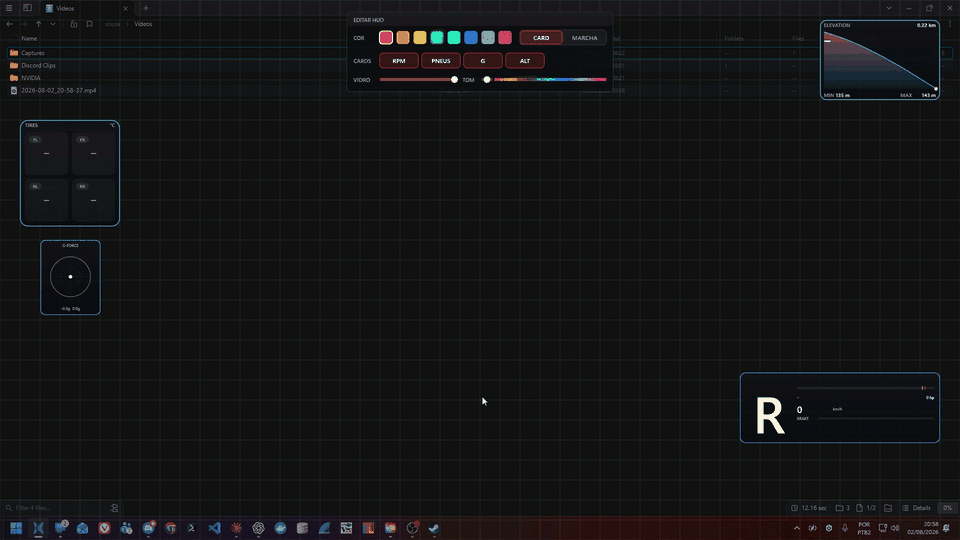

<p align="center">
  
</p>

<h1 align="center">Veloryft HUD</h1>

<p align="center"><strong>A fast, native telemetry overlay for Forza Horizon 6 on Windows.</strong></p>
<p align="center">Direct2D rendering · Click-through panels · Adaptive shift points · Local-only data</p>

<p align="center">
  <a href="https://github.com/enoquesousa/veloryft-hud/actions/workflows/ci.yml"></a>
  <a href="https://github.com/enoquesousa/veloryft-hud/releases"></a>
  <a href="LICENSE"></a>
  
  
</p>

<p align="center">
  <a href="https://veloryft.com">Website</a> ·
  <a href="#download">Download</a> ·
  <a href="#quick-start">Quick start</a> ·
  <a href="#features">Features</a> ·
  <a href="#build-from-source">Build</a> ·
  <a href="docs/README.md">Documentation</a>
</p>

> [!IMPORTANT]
> Veloryft is an open beta. Releases are immutable and versioned; beta builds
> are marked as prereleases so stable download links never resolve to an
> experimental build.

## Why Veloryft

Veloryft turns Forza Horizon 6's built-in UDP telemetry into a responsive HUD without
injecting code, reading game memory, or sending data anywhere. Each panel is a
small native layered window that stays transparent to mouse input, so the game
remains fully interactive underneath it.

| Focus | What it means |
| --- | --- |
| **Immediate feedback** | The critical throttle surface updates on its own high-priority 125 Hz path. |
| **Useful shift timing** | Shift points are learned from each car's observed power delivery and RPM drop. |
| **Native presentation** | Direct2D, DirectWrite, per-pixel alpha, DPI awareness, and no embedded browser. |
| **Private by design** | No account, analytics, crash upload, update check, HTTP client, or outbound socket. |
| **Reproducible builds** | A public clone builds without private repositories, access tokens, or license secrets. |

## Features

- Configurable RPM, gear, speed, brake, throttle, and power cluster.
- Per-corner tire temperatures with session minimum and maximum values.
- Lateral and longitudinal G-force display with a decaying trail.
- Lap elevation profile with a live position marker.
- Per-car adaptive rev-limit and shift-point learning.
- Drag, resize, snap, recolor, and restyle panels in edit mode.
- Automatic visibility in menus, pause screens, replays, and cutscenes.
- Installer and portable distributions with published SHA-256 checksums.
- Optional track-mapping feature, disabled in standard release builds.

### Edit mode

Press **Ctrl + Alt + E** to move, resize, snap, recolor, and restyle each HUD
panel directly on the desktop.

<p align="center">
  
</p>

_This recording uses an earlier Portuguese development build. Current builds
use the English labels defined by the [localization catalog](src/localization/en_us.rs)._

## Download

Choose a package from [GitHub Releases](https://github.com/enoquesousa/veloryft-hud/releases):

| Package | Best for |
| --- | --- |
| `Veloryft-Setup-<version>.exe` | Normal installation, Start menu shortcut, and uninstaller. |
| `Veloryft-Portable-<version>.zip` | Running without installation or from a removable folder. |
| `SHA256SUMS` | Verifying that downloads match the published artifacts. |

> [!WARNING]
> Beta binaries are not code-signed yet, so Windows SmartScreen may warn you.
> Verify the download against `SHA256SUMS` before selecting **More info → Run
> anyway**.

```powershell
(Get-FileHash .\Veloryft-Setup-0.2.0-beta.1.exe).Hash.ToLowerInvariant()
```

Requirements: 64-bit Windows 10 or later and Forza Horizon 6 with Data Out
telemetry. No Visual C++ Redistributable or separate runtime is required.

## Quick start

### 1. Enable telemetry

In Forza Horizon 6, open **Settings → HUD and Gameplay → Data Out** and set:

| Setting | Value |
| --- | --- |
| Data Out | On |
| IP address | `127.0.0.1` |
| Port | `20066` |

<p align="center">
  
</p>

Some titles label the option **Telemetry Output**. See the complete
[game configuration guide](docs/getting_started/game_configuration.md).

### 2. Start driving

The HUD appears after active telemetry arrives. Staying hidden in menus is
intentional.

| Shortcut | Action |
| --- | --- |
| **Ctrl + Alt + E** | Enter edit mode. |
| **Ctrl + Alt + H** | Hide or show the HUD. |
| **Ctrl + Alt + Q** | Quit Veloryft. |

Veloryft also provides Show/Hide and Exit actions from its system-tray icon.

### 3. Optional vehicle names

Forza Horizon 6 sends a numeric car ordinal, not a display name. Veloryft shows that
ordinal by default because it does not redistribute an unlicensed community
catalog. You can supply your own local mapping through `FORZA_CAR_ORDINALS`;
see [vehicle catalog](docs/reference/vehicle_catalog.md).

## Privacy

**Nothing leaves your machine.** The standard build receives UDP telemetry and
writes only settings, learned shift points, and bounded diagnostics under
`%APPDATA%\forza-hud-native`.

The dependency graph contains no HTTP client or TLS stack. The optional
`track_mapping` feature adds a loopback-only local server, but it is disabled in
published builds. Details and verification guidance are in the
[privacy documentation](docs/security/privacy.md).

## Build from source

You need 64-bit Windows, Rust with the MSVC toolchain, and the Visual Studio
Build Tools C++ workload.

```powershell
git clone https://github.com/enoquesousa/veloryft-hud.git
cd veloryft-hud
cargo build --release --locked
```

No Forza Horizon 6 installation is needed for development. Run the application and the
synthetic sender in separate terminals:

```powershell
cargo run
```

```powershell
cargo run --example synthetic_telemetry
```

The sender exercises Sled, Dash, and FH6 packet layouts and can simulate idle
telemetry for visibility testing.

## Architecture

```text
Forza Horizon 6
  └─ UDP telemetry
       └─ zero-copy packet parser
            └─ lock-free ArcSwap snapshot
                 ├─ cluster and auxiliary panel renderers
                 └─ isolated critical-throttle surface at 125 Hz
                      └─ Direct2D → premultiplied DIB → UpdateLayeredWindow
```

The native overlay is split into application, telemetry, rendering, settings,
localization, and optional track-mapping boundaries. Start with the
[system overview](docs/architecture/system_overview.md),
[rendering pipeline](docs/architecture/rendering_pipeline.md), and
[repository structure](docs/architecture/repository_structure.md).

## Quality gates

Pull requests run formatting, documentation, the declared minimum Rust version,
Linux protocol tests, Windows builds, Clippy, default/all-feature tests, release
compilation, dependency licensing, and RustSec advisories.

```powershell
cargo fmt --all -- --check
cargo clippy --workspace --all-targets --all-features -- -D warnings
cargo test --workspace --all-features
cargo deny check
cargo audit
```

See [CONTRIBUTING.md](CONTRIBUTING.md) before changing the render hot path or
adding `unsafe` code.

## Documentation

| Area | Entry point |
| --- | --- |
| Use the HUD | [Getting started](docs/getting_started/first_run.md) |
| Understand the system | [Architecture](docs/architecture/system_overview.md) |
| Develop and test | [Development setup](docs/development/development_setup.md) |
| Build releases | [Release process](docs/distribution/release_process.md) |
| Review security and privacy | [Security model](docs/security/security_model.md) |
| Find configuration contracts | [Reference](docs/README.md#reference) |

Issues and pull requests are welcome. Use [SUPPORT.md](SUPPORT.md) for help and
[SECURITY.md](SECURITY.md) for private vulnerability reporting.

## License and trademarks

The source and official binaries are licensed under [Apache-2.0](LICENSE).
Attribution and dependency details are in [NOTICE](NOTICE) and
[THIRD_PARTY_NOTICES.md](THIRD_PARTY_NOTICES.md).

The **Veloryft** name and logo are not granted under Apache-2.0. Forks may use
the code but must follow [TRADEMARKS.md](TRADEMARKS.md) when naming and branding
distributed builds.

Veloryft is not affiliated with, sponsored by, or endorsed by Microsoft, Xbox,
Turn 10 Studios, Playground Games, or any vehicle manufacturer. Product and
company names are used only to describe compatibility.
