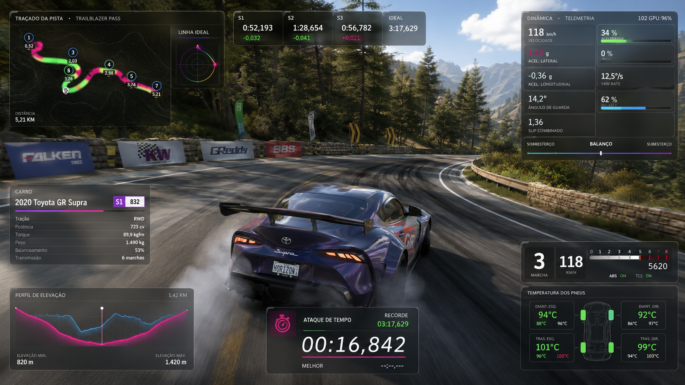

# Veloryft

HUD de telemetria nativo para Forza no Windows. Escrito em Rust, desenhado com
Direct2D, e o clique atravessa direto para o jogo.



> **Beta aberto.** Funciona e já é usado, mas espere arestas. Não há verificação
> de licença, conta nem chave — baixe e execute.

> **Sobre este documento:** é um resumo. A documentação completa está em inglês,
> em [`docs/`](docs/README.md), e é a fonte canônica. Não existem duas
> documentações paralelas: se algo aqui divergir, o inglês vale.

*[Read in English](README.md)*

## O que ele faz

- **RPM, marcha, velocidade e pedais** num cluster que você posiciona.
- **Ponto de troca aprendido do seu carro**, não estimado por uma porcentagem do
  corte. O Veloryft observa o que o carro faz a todo gás e calcula onde segurar
  a marcha deixa de compensar.
- **Temperatura dos pneus** por roda, com a faixa da sessão.
- **Força G** — carga lateral e longitudinal, com rastro que desvanece.
- **Perfil de elevação da volta**, com um marcador da sua posição.
- **Click-through real.** O mouse chega ao jogo, não ao overlay.
- **Ele se esconde sozinho** em menus, pausa, replays e cinemáticas, e volta
  quando você começa a dirigir.

## Privacidade

**Nada sai da sua máquina.** Sem conta, sem analytics, sem verificação de
atualização, sem nenhum código de rede de saída. O Veloryft lê a telemetria que
o jogo transmite para `127.0.0.1` e grava configurações na sua própria pasta de
perfil.

Você não precisa acreditar: o código é público, o grafo de dependências não tem
cliente HTTP nem pilha TLS, e um firewall mostra que nada sai. Veja
[privacidade](docs/security/privacy.md).

## Requisitos

- Windows 10 de 64 bits ou mais recente
- Um jogo Forza com telemetria "Data Out"
- Mais nada — sem Visual C++ Redistributable, sem runtime

## Para usuários

### 1. Baixe

Em [Releases](https://github.com/ESousa97/veloryft-hud/releases):

| | |
| --- | --- |
| `Veloryft-Setup-<versão>.exe` | Instalador, com atalho no menu Iniciar e desinstalador |
| `Veloryft-Portable-<versão>.zip` | Descompacte e execute; nada é instalado |

### 2. Confira o arquivo

Os arquivos **não são assinados digitalmente**, então o SmartScreen vai avisar.
Confira o hash contra o `SHA256SUMS` publicado antes de executar:

```powershell
(Get-FileHash .\Veloryft-Setup-0.2.0-beta.1.exe).Hash.ToLower()
```

Se bater, clique em **Mais informações** → **Executar assim mesmo**. Se não
bater, não execute.

### 3. Ligue a telemetria no jogo

**Configurações → HUD e Jogabilidade → Data Out**

| Opção | Valor |
| ----- | ----- |
| Data Out | Ligado |
| Endereço IP | `127.0.0.1` |
| Porta | `20066` |

Alguns títulos chamam essa seção de "Telemetry Output".

### 4. Dirija

O HUD aparece em cerca de um segundo depois que você se move. Em menus não
aparece nada — isso é proposital.

| Atalho | Ação |
| ------ | ---- |
| **Ctrl + Alt + E** | Modo de edição: arrastar, redimensionar, mudar cores |
| **Ctrl + Alt + H** | Ocultar ou mostrar |
| **Ctrl + Alt + Q** | Sair |

O Veloryft também fica na bandeja do sistema, normalmente atrás da seta de
ícones ocultos.

### Desinstalar

Configurações → Aplicativos → Veloryft → Desinstalar, ou apague a pasta portable.

**Suas configurações são mantidas**, então reinstalar recupera o layout e tudo
que o Veloryft aprendeu sobre seus carros. Para apagar também:

```powershell
Remove-Item -Recurse "$env:APPDATA\forza-hud-native"
```

### Algo deu errado

O [guia de solução de problemas](docs/getting_started/troubleshooting.md) cobre
os casos comuns — o HUD não aparecer (quase sempre é o Data Out), painéis fora
da tela depois de trocar a resolução, atalhos tomados por outro programa.

Os logs ficam em `%APPDATA%\forza-hud-native\logs\veloryft.log`.

## Para quem quer contribuir

Clone só este repositório. Não há dependências privadas nem tokens.

```bash
git clone https://github.com/ESousa97/veloryft-hud
cd veloryft-hud
cargo build --release
```

Dá para trabalhar sem ter o Forza:

```bash
cargo run
```

```bash
cargo run --example synthetic_telemetry
```

Leia o [CONTRIBUTING.md](CONTRIBUTING.md) (em inglês) antes de abrir um pull
request — em especial as regras do caminho crítico de renderização, que não é
código comum.

## Como funciona

```
Forza  ──UDP──▶  parsing  ──▶  snapshot lock-free  ──▶  Direct2D  ──▶  janela layered
```

Cada painel é uma janela pequena `WS_EX_LAYERED | WS_EX_TRANSPARENT` própria. O
Direct2D desenha num DIB pré-multiplicado e o `UpdateLayeredWindow` entrega ao
compositor — alpha por pixel na GPU, e cliques que atravessam para o processo do
jogo. Uma superfície transparente em tela cheia treme; esta não. Veja a
[ADR 0001](docs/decisions/adr_0001_native_direct2d_overlay.md).

Detalhes: [visão geral do sistema](docs/architecture/system_overview.md).

## Licença

[Apache-2.0](LICENSE). Componentes de terceiros estão em
[THIRD_PARTY_NOTICES.md](THIRD_PARTY_NOTICES.md).

O nome **Veloryft** e o logo são marcas e não estão cobertos por essa licença —
faça fork à vontade, mas renomeie a sua build. Veja
[TRADEMARKS.md](TRADEMARKS.md).

## Sem afiliação

"Forza", "Forza Horizon", "Forza Motorsport", "Xbox" e "Microsoft" são marcas da
Microsoft Corporation. "Turn 10 Studios" e "Playground Games" são nomes de seus
respectivos donos.

**O Veloryft não é afiliado, patrocinado nem endossado por nenhum deles.** Ele lê
apenas a telemetria que o próprio jogo transmite quando você a habilita. Não
modifica o jogo, não lê sua memória e não injeta código.
